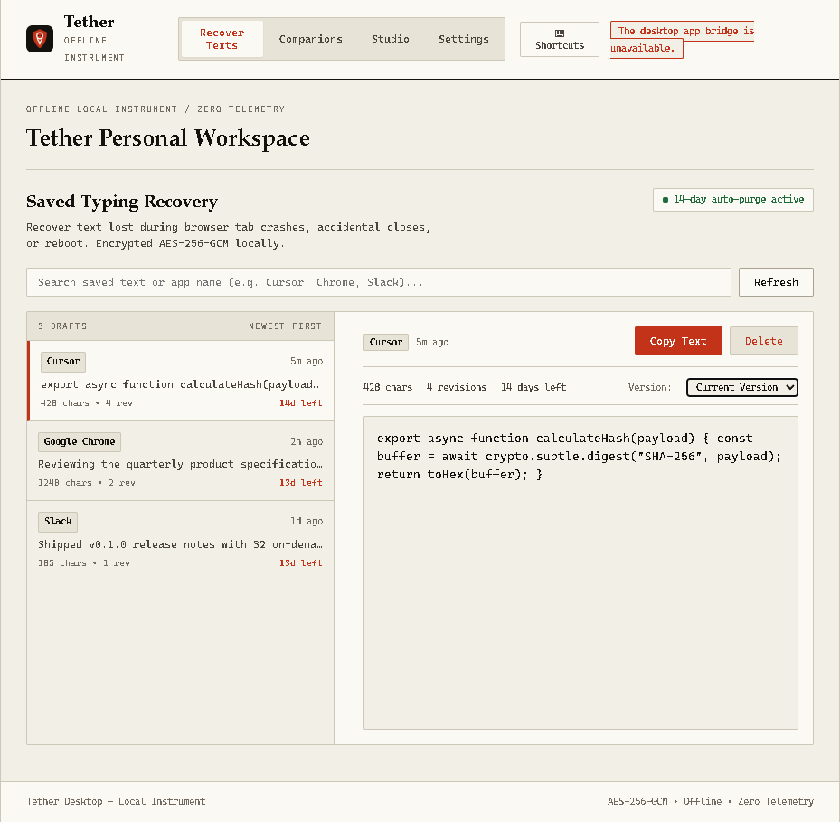
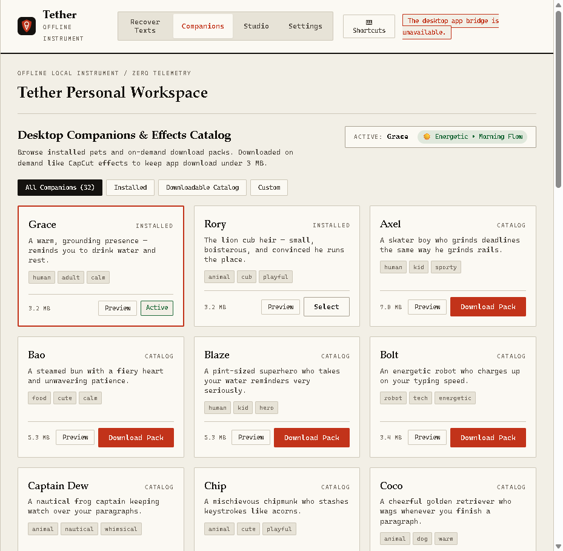
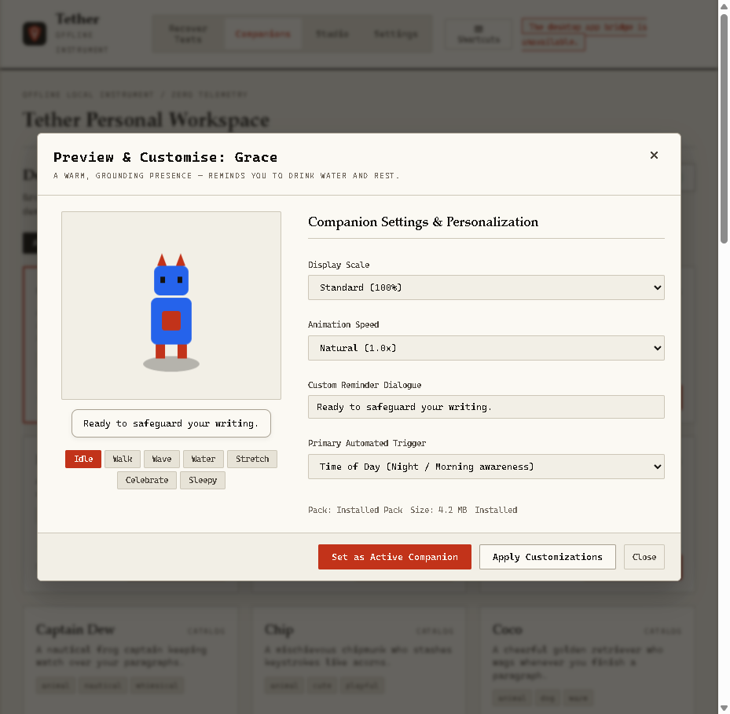
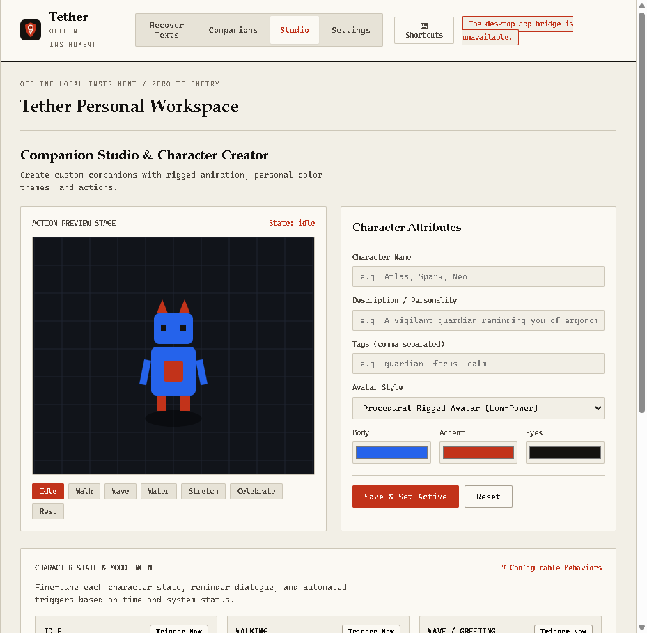
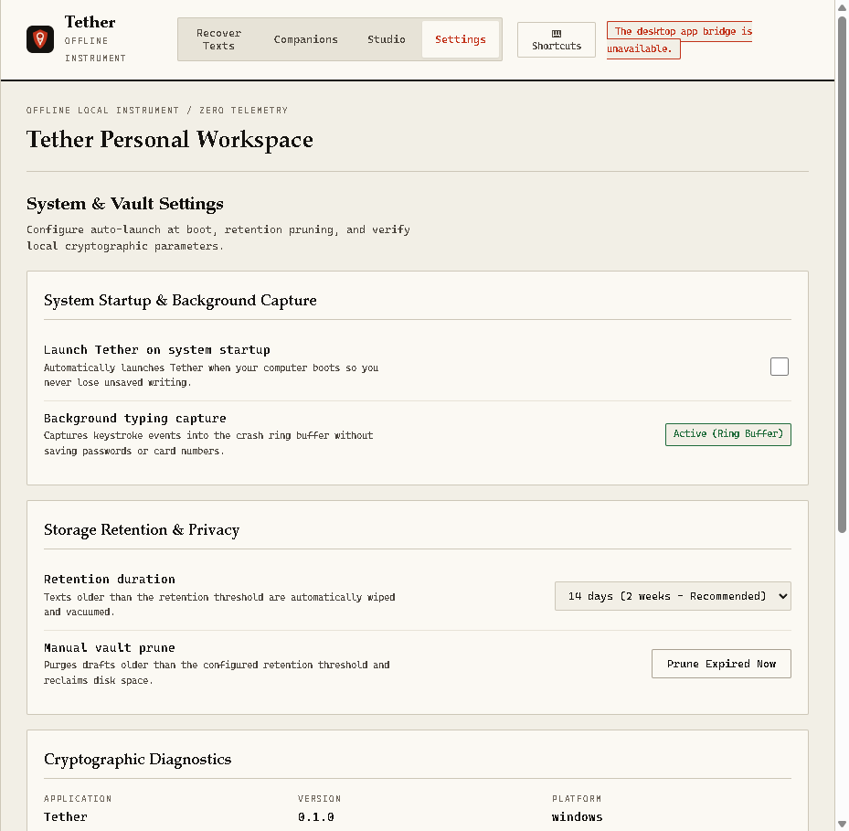

<div align="center">

<p align="center">
  
</p>

# Tether

<p align="center">
  <a href="https://github.com/AMG555/Tether/actions/workflows/ci.yml"></a>
  <a href="LICENSE"></a>
  <a href="https://blog.rust-lang.org/2023/12/28/Rust-1.75.0.html"></a>
  <a href="#desktop-application--gui"></a>
  <a href="#weight-measured"></a>
  <a href="#privacy-the-part-that-matters"></a>
  <a href="SECURITY.md"></a>
</p>

**100% offline crash recovery, typing autosave, and desktop companion engine.**<br>
*Recover unsaved text after an app crash, freeze, force-quit, power outage, or OS restart.*

Tether is a privacy-first, ultra-fast local crash recovery instrument written in Rust. While active, it captures typing into a sub-millisecond append-only encrypted ring buffer and flushes drafts into an AES-256-GCM SQLite vault. **Zero network calls. Zero cloud telemetry. Zero subscriptions.** Sensitive fields like passwords, crypto seed phrases, tokens, and credit cards are blocked or masked before disk.

Choose between a **featherlight native Desktop GUI** (Tauri 2) with 32 downloadable companion characters, live state previews, and circadian timing, or an **invisible terminal CLI daemon**.

<br>

**[Quick Start](#quick-start) · [Desktop App](#desktop-application--gui) · [32 Companions](#32-companion-characters--on-demand-packs) · [Character Studio & States](#character-studio--state-engine) · [Uninstall](#clean-uninstallation) · [Privacy](#privacy-the-part-that-matters) · [Architecture](#architecture)**

<br>



</div>

---

## Highlights

- 🛡️ **Minimal Network Footprint**: Zero telemetry, zero external APIs, zero background phone-home. The CLI has no network code path whatsoever (enforced by `tests/privacy.rs::shipped_source_contains_no_network_calls`). The desktop shell makes one optional, checksum-verified HTTPS request when installing a companion pack not already on disk; no other network traffic is ever initiated.
- ⚡ **Instant Crash Recovery**: Sub-millisecond ring buffer writes (`~4 µs/key`). Recovers text even after sudden `SIGKILL`, system kernel panic, or power cut.
- 🔐 **Military-Grade Local Vault**: AES-256-GCM encryption at rest with HKDF-derived keys and SQLite WAL mode.
- 🕒 **14-Day Rolling Retention**: Saved texts automatically prune after 14 days by default. Complete control over retention windows.
- 🖥️ **Tauri 2 Native Desktop App**: Modern, accessible desktop client with instant search, revision timeline, and one-click copy.
- 🐾 **32 Desktop Companions**: On-demand downloadable animated companion packs (CapCut-style asset streaming) keeping initial installer under 4 MB.
- 🎭 **Live Preview & State Engine**: Full control over character behaviors (`idle`, `walk`, `wave`, `water`, `stretch`, `happy`, `sad`), speech bubbles, scales, and speeds.
- ⏰ **Dynamic Timing & System Awareness**: Companions adapt their mood and reminders to local time of day (Morning Flow, Hydration, Evening Stretch, Night Owl) and battery health.
- ⌨️ **Global Shortcut & Hotkeys**: Instant access via `Ctrl+Alt+T` global hotkey, with full in-app navigation (`Ctrl+1..4`, `Ctrl+F`, `Ctrl+R`, `?`).
- 🧹 **Complete Clean Uninstall**: 1-click uninstaller in Desktop Settings, `tether uninstall [--purge]` CLI command, and standalone removal scripts.

---

## Desktop Application & GUI

Tether includes a native desktop application powered by **Tauri 2** and system webviews. Designed for accessibility, responsive high-DPI displays, and zero resource waste:

````carousel

<!-- slide -->

<!-- slide -->

<!-- slide -->

<!-- slide -->

````

### Key Desktop Capabilities

1. **Saved Drafts & Revision History**: Search drafts across all applications, inspect revisions, see word counts, and copy back to your clipboard in one click (`Ctrl+C`).
2. **On-Demand Companion Downloads**: Browse 32 curated animated companion characters. Download only what you want directly to your local machine.
3. **Interactive Character Preview**: Test every animation state, customize speech lines, adjust scale (80%–150%) and playback speed (0.7x–1.3x) before activating.
4. **Studio Customizer**: Author bespoke characters from animated WebP clips or create procedural rigs with tailored color palettes, proportions, and personality quirks.
5. **System Settings & Diagnostics**: Toggle start-at-login autostart, configure rolling retention days (1–90 days), inspect vault encryption status, and run one-click uninstallation.

---

## 32 Companion Characters & On-Demand Packs

To keep the application download tiny (`< 4 MB`), Tether uses a lightweight on-demand asset model (inspired by CapCut video effects). Companions are downloaded directly to `%LOCALAPPDATA%\Tether\companions` or `~/.local/share/tether/companions` only when requested.

| Category | Companions | Personality & Style |
|---|---|---|
| **Classics** | Grace, Rory, Finn, Spike | Balanced productivity, gentle focus, hydration pacing |
| **Energetic** | Blaze, Bolt, Zippy, Axel | High-tempo sprints, coding velocity, victory celebrations |
| **Cozy & Calm** | Bao, Coco, Daisy, Marmalade | Soft pauses, posture alignment, tea & breathing reminders |
| **Tech & Cyber** | Pixel, Quest, Doc, Shadow | Monospace vibes, terminal aesthetics, debugging encouragement |
| **Nature & Zen** | Nimbus, Splash, Zen, Sage | Ambient tranquility, deep thinking, eye relief prompts |
| **Whimsical** | Captain Dew, Chip, Ember, Iris, Luna, Nova, Ollie, Peanut, Penny, Theo, Twirl, Waddle | Playful deskside companions with custom dialogue lines |

Every companion includes distinct animation clips: `idle`, `walk`, `wave`, `water`, `stretch`, `happy`, and `sad`.

---

## Character Studio & State Engine

Manage each companion's emotional states and physical presence right inside the desktop app:

```
[Character State Engine]
  ├── Idle      ──> Gentle ambient loop while working
  ├── Walk      ──> Patrols across active dock or taskbar
  ├── Wave      ──> Friendly greeting upon startup or app switch
  ├── Water     ──> Hydration nudge at programmed intervals
  ├── Stretch   ──> Posture and eye-strain micro-break cue
  ├── Happy     ──> Triggered when long typing drafts save safely
  └── Sad       ──> Soft alert on unexpected application exit
```

- **Live Speed & Scale Controls**: Tune animation playback speed from `0.7x` (relaxed) to `1.3x` (brisk) and scale from `80%` to `150%`.
- **Custom Quote Dialogues**: Assign unique reminder lines to each character state.
- **Trigger Now Testing**: Manually trigger any state on demand to inspect animations without waiting for timers.

---

## Dynamic Timing & System Status

Tether monitors system health and circadian time passively without recording keystroke content:

- 🌅 **Morning Flow (06:00 – 12:00)**: Companions offer energized greetings, focusing on morning momentum and clear task setup.
- 💧 **Hydration & Posture (12:00 – 17:00)**: Regular water reminders and ergonomics checks during the afternoon stretch.
- 🧘 **Evening Wind-Down (17:00 – 22:00)**: Soft stretch prompts to prevent eye fatigue as the workday winds down.
- 🌙 **Night Owl Mode (22:00 – 06:00)**: Subdued animations, dimmed speech bubbles, and sleep reminders for late-night sessions.
- 🔋 **Battery Awareness**: Companions adapt their energy levels and remind you to plug in when battery levels drop below 20%.

---

## Quick Start & Installation

### Option 1: One-Click Windows Setup (Recommended)

Download and run the automated Windows setup script:

```bat
:: Double click setup-windows.bat in the root folder, or run in cmd/PowerShell:
.\setup-windows.bat
```

This checks prerequisites, compiles the release binaries, initializes the encrypted vault, configures login autostart, and places desktop and start menu shortcuts (`Ctrl+Alt+T`).

### Option 2: PowerShell One-Liner (Windows)

```powershell
irm https://raw.githubusercontent.com/AMG555/Tether/main/scripts/install.ps1 | iex
tether setup --autostart
```

*Installer verifies SHA-256 checksums, configures desktop shortcuts with `Ctrl+Alt+T`, and adds Tether to your user `PATH`.*

### Option 3: Shell One-Liner (Linux & macOS)

```sh
curl -fsSL https://raw.githubusercontent.com/AMG555/Tether/main/scripts/install.sh | sh
tether setup --autostart
```

### Option 4: Build from Source

Prerequisites: [Rust 1.75+](https://rustup.rs/) and [Node.js 18+](https://nodejs.org/) (for Desktop GUI).

```sh
# Clone repository
git clone https://github.com/AMG555/Tether.git
cd Tether

# Build lightweight CLI binary (~2.5 MB)
cargo build --release

# Build native Desktop GUI application (~3.7 MB)
npm --prefix desktop install
cargo build --manifest-path desktop/src-tauri/Cargo.toml --release

# First-time setup
.\target\release\tether.exe setup --autostart
```

---

## Keyboard Shortcuts

Navigate Tether at full speed with hotkeys:

| Scope | Shortcut | Action |
|---|---|---|
| **Global OS** | `Ctrl + Alt + T` | Launch or focus Tether desktop window |
| **In-App Navigation** | `Ctrl + 1` | Switch to **Recover** tab (Saved Drafts) |
| | `Ctrl + 2` | Switch to **Companions** tab |
| | `Ctrl + 3` | Switch to **Studio** tab |
| | `Ctrl + 4` | Switch to **Settings** tab |
| **Actions** | `Ctrl + F` or `/` | Focus search bar in Recover view |
| | `Ctrl + R` | Refresh drafts list from encrypted vault |
| | `Ctrl + C` | Copy currently selected draft to clipboard |
| | `?` or `Ctrl + /` | Open Keyboard Shortcuts cheat sheet |
| | `Escape` | Dismiss open preview modals and dialogs |

---

## Clean Uninstallation

Tether respects your machine. When you uninstall, everything can be cleaned up cleanly and completely:

### 1. From the Desktop App (GUI)
1. Open **Settings** tab (`Ctrl+4`).
2. Scroll to the **Danger Zone** at the bottom.
3. Click **Uninstall Tether**.
4. Check **Purge all encrypted vault data** if you wish to wipe drafts, encryption keys, and companion files.
5. Confirm uninstall — Tether deregisters startup entries, wipes specified paths, and closes cleanly.

### 2. From the Command Line (CLI)
```sh
# Clean uninstallation (removes autostart, stops background daemons, cleans binaries)
tether uninstall

# Total purge uninstallation (also deletes encrypted vault, keys, and companion packs)
tether uninstall --purge
```

### 3. Dedicated Scripts
- **Windows**: Run `powershell -ExecutionPolicy Bypass -File scripts\uninstall.ps1 -Purge`
- **Linux / macOS**: Run `sh scripts/uninstall.sh --purge`

---

## How Capture Works


Tether uses a dual-tier storage architecture designed to never drop a character:

| Storage Layer | Durability & Scope | Latency |
|---|---|---|
| **Crash Ring** | Fixed-slot append-only file. Survives process crashes, force-quits, `SIGKILL`, and OOM kills. | **~4 µs** per keystroke |
| **Encrypted Vault** | SQLite WAL mode with AES-256-GCM encryption. Stores structured drafts and revisions across reboots. | **~1.2 ms** per flush (~1s) |

```
   User Typing
       │
       ▼
 ┌─────────────┐    Sanitizes secrets     ┌──────────────┐    Every ~1s    ┌─────────────┐
 │  OS Capture ├─────────────────────────►│  Crash Ring  ├────────────────►│   Vault     │
 │  (Hook/Tap) │    Blocks password apps  │  (Encrypted) │    Encrypted    │ (AES-256-GCM│
 └─────────────┘    Masks payment cards   └──────┬───────┘    SQLite WAL   │  Revisions) │
                                                 │                         └──────┬──────┘
                                          Process Dies ──┐                        │
                                                         ▼                        ▼
                                                `tether recover`         `tether list`
```

### Platform Keystroke Support

| Platform | Keystroke Hook | Clipboard Fallback | Elevation Required |
|---|---|---|---|
| **Windows 10 / 11** | ✅ `WH_KEYBOARD_LL` + `ToUnicodeEx` layout mapping | ❌ Excluded from capture | **None** (User space) |
| **macOS 13+** | ✅ `CGEventTap` + Accessibility probe | ❌ Excluded from capture | Accessibility permissions |
| **Linux (X11 / Wayland)** | ⚠️ Clipboard-only (Security design) | ✅ `xclip` / `wl-clipboard` | **None** (User space) |

---

## Privacy: The Part That Matters

Because Tether records keyboard interactions, security and ethics are enforced at the compiler level:

1. **Pre-Write Filtering**:
   - **Always Blocked**: 1Password, Bitwarden, KeePassXC, LastPass, Dashlane, Enpass, Keeper, NordPass, Proton Pass, macOS Keychain, Windows Credential Manager, BitLocker, VeraCrypt, MetaMask, Phantom, Ledger Live, Trezor.
   - **Pattern Blocked**: Window titles containing "sign in", "reset password", "2FA", "CVV", "credit card", "seed phrase", "private key".
   - **Secret Masking**: Luhn-valid credit card numbers, JWT tokens, PEM private keys, AWS/GitHub/OpenAI tokens are masked with `█` characters before touching disk.
2. **Encrypted at Rest**:
   - AES-256-GCM encryption with per-purpose HKDF key derivation.
   - Files created with `0600` permissions (`0700` directories) on Unix; protected by user SID ACLs on Windows.
3. **Network Traffic**:
   - **CLI: zero network.** No telemetry, no sync, no network code path at all. Enforced by `tests/privacy.rs::dependencies_are_offline_only` (dependency scan) and `tests/privacy.rs::shipped_source_contains_no_network_calls` (source-level scan for subprocess and socket calls).
   - **Desktop shell: one optional, verified request.** When installing a companion pack not already on disk, the shell fetches `checksums.txt` and the companion zip over HTTPS, verifies SHA-256 before writing anything, and deletes the temp file on mismatch. No other network calls are made.

---

## CLI Command Reference

```
tether setup [--autostart]          Guided first run: creates vault, permissions, checks
tether run [--mode ...]             Start foreground capture engine (Ctrl-C commits)
tether recover                      Replay pending crash ring buffer into encrypted vault
tether list [-n 20] [--preview N]   Display recent typing drafts with timestamps
tether show <id> [--bare]           Output full recovered draft
tether copy <id>                    Place recovered text directly on system clipboard
tether search <query>               Fast in-memory decrypt-and-search across drafts
tether revisions <id>               View past revisions of a specific draft
tether prune [--max-days 14]        Prune drafts older than retention window (default 14 days)
tether purge --yes                  Wipe all vault data, vacuum SQLite, clear crash ring
tether uninstall [--purge]          Cleanly uninstall autostart and delete binaries/vault
tether ask                          Launch desktop companion
tether ask --character-studio       Open offline Character Studio in local browser
tether ask --clips                  Inspect installed clip states for current character
tether doctor                       Verify DB integrity, permissions, and buffer state
```

---

## Weight, Measured

Benchmarked on x86-64 release builds:

| Metric | Measured Value | Notes |
|---|---|---|
| **CLI Binary** | **1.99 MB** | `opt-level="z"`, LTO, abort on panic, stripped |
| **Desktop App Binary** | **3.71 MB** | Full Tauri 2 GUI client, bundled webview shell |
| **Idle Memory (RSS)** | **4.3 MB** | Resident set size while capturing |
| **Capture Latency** | **4.1 µs** | Average latency per keystroke event |
| **Commit Latency** | **1.2 ms** | Ingest, sanitize, encrypt, and WAL commit |
| **Cold Startup** | **4.4 ms** | `tether status` execution time |
| **Runtime Dependencies** | **None** | SQLite compiled directly into binary |

---

## Architecture

Modular Rust codebase structured into eleven isolated domain modules:

| Module | Core Responsibility |
|---|---|
| [`src/crypto.rs`](src/crypto.rs) | AES-256-GCM encryption, HKDF key derivation, nonces |
| [`src/policy.rs`](src/policy.rs) | Secret scanning, sensitive application detection, masking |
| [`src/ring.rs`](src/ring.rs) | Encrypted append-only crash buffer with torn-write prevention |
| [`src/recover.rs`](src/recover.rs) | Event reconstruction, grapheme-aware backspace handling |
| [`src/vault.rs`](src/vault.rs) | SQLite WAL encrypted storage, blind indexing, revisions |
| [`src/engine.rs`](src/engine.rs) | Orchestrates capture pipeline: Policy → Ring → Vault |
| [`src/remind.rs`](src/remind.rs) | Circadian break timer (presence-aware, content-blind) |
| [`src/avatar/`](src/avatar/) | Character manifest validation, animated WebP/APNG auditor |
| [`src/setup.rs`](src/setup.rs) | Guided system check, autostart installer, and uninstaller |
| [`desktop/`](desktop/) | Tauri 2 native desktop app frontend & IPC commands |

---

## License

Released under the **MIT License**. Created and maintained by **AMG555**.
See [LICENSE](LICENSE) for details.
