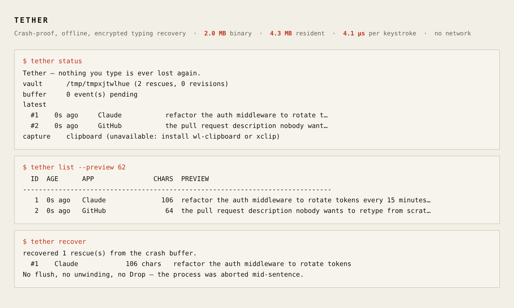
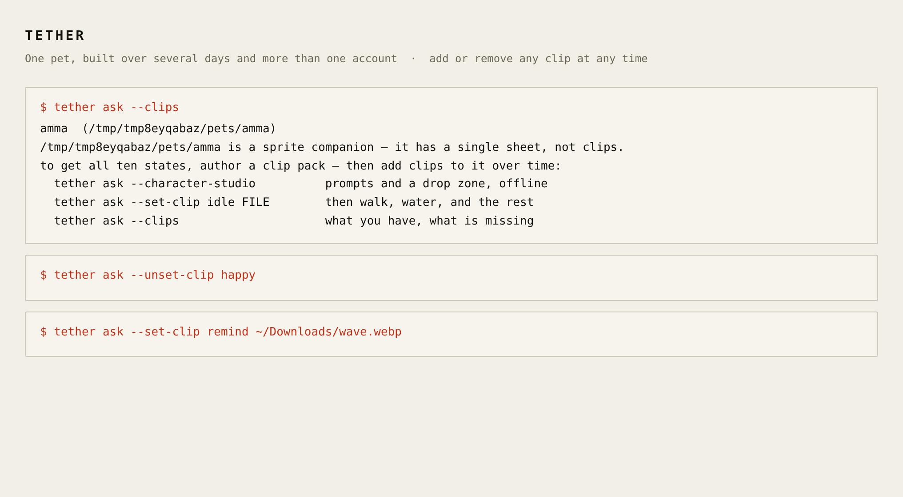
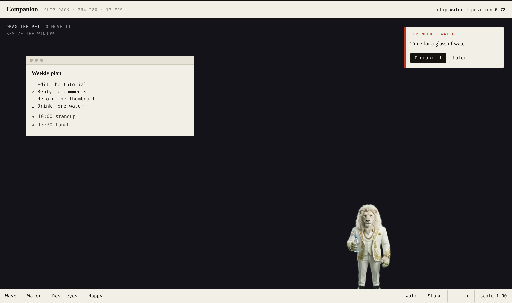
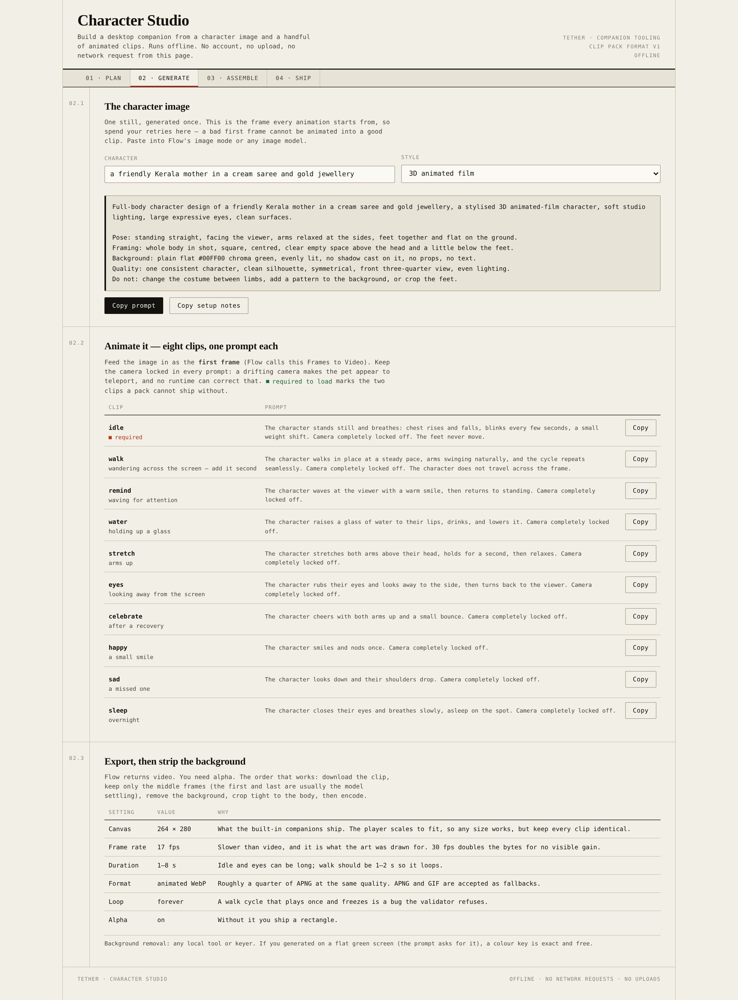

<div align="center">

# Tether

**Recover unsaved text after an app crash, force-quit, or restart.**

Tether is a local command-line recovery tool. While capture is running, it records supported text
input and stores recoverable drafts in an encrypted local vault. Windows and macOS capture
keystrokes; Linux is clipboard-only. Capture filters reduce risk, but they cannot recognize every
sensitive field. Review [privacy](#privacy-the-part-that-matters) and
[known limitations](docs/limitations.md) before enabling it.

An optional companion offers built-in characters and custom sprite or animated clip packs. Its CLI
workflows are available now; the separate native desktop shell is still a development preview, not
a finished recovery app.

<br>

**[Install](#install) · [The companion](#the-companion) · [How capture works](#how-capture-works) · [Privacy](#privacy-the-part-that-matters) · [Limits](#what-it-does-not-protect-against) · [Docs](docs/)**

<br>



<sub>Real output from the release binary. No mockups in this repo.</sub>

</div>

---

## Install

The one-command installers require a tagged GitHub release with platform binaries and checksums.
If the [Releases page](https://github.com/AMG555/Tether/releases) has no release yet, build from
source once the repository files are available:

```sh
git clone https://github.com/AMG555/Tether.git
cd Tether
cargo build --release
```

Rust 1.75+ is required. SQLite is compiled in; the CLI has no runtime dependencies.
Run `./target/release/tether setup` on Linux/macOS or
`.\target\release\tether.exe setup` in PowerShell to create the local vault.

<details>
<summary>Install from a release (after one is published)</summary>

**Linux / macOS**

```sh
curl -fsSL https://raw.githubusercontent.com/AMG555/Tether/main/scripts/install.sh | sh
tether setup
```

**Windows** (PowerShell)

```powershell
irm https://raw.githubusercontent.com/AMG555/Tether/main/scripts/install.ps1 | iex
tether setup
```

The installer downloads the build for your platform, **verifies its SHA-256 against the published
`checksums.txt`, and refuses to install on a mismatch.** It writes to `~/.local/bin` (or
`%LOCALAPPDATA%\Tether\bin`), never to `/usr/local`, and tells you exactly what to add to your
`PATH` if you need to. Re-running it upgrades in place.

</details>

After installing, run `tether setup` once. It creates the vault, checks file permissions, states
what capture is available on your OS, and prints a fix beside anything that is wrong:

```
$ tether setup

[1/3] creating the vault
vault:   /home/you/.local/share/tether
keyfile: /home/you/.local/share/tether/key.txt  (chmod 600)
...
[2/3] checks
  ok    capture      the clipboard — Linux has no safe system-wide keystroke API; this is a deliberate limit
  ok    permissions  700 (private)
  warn  key backup   the key sits next to the vault: losing the disk loses both
                     fix: copy .../key.txt somewhere separate (password manager, USB stick)
  warn  start at login not installed — a crash only counts if Tether was already running
                     fix: tether setup --autostart
```

If anything blocking is left, it exits non-zero and says what to do. `tether setup --autostart`
installs a systemd user unit, a LaunchAgent, or a Windows startup item — because **a recovery tool
that starts after the crash recovers nothing.**

## Desktop shell (development)

The native Tauri desktop shell is under development. From a source checkout, install Node.js 22+,
Rust 1.90+, and the target platform's Tauri build prerequisites, then run:

```sh
npm --prefix desktop install
npm --prefix desktop run tauri:dev
```

This opens a native app window; it is not an installer. The current shell is a development preview:
its Windows window opens, but its local metadata bridge is not yet initializing. Saved-text recovery
and pet customization are also not in the shell yet; use the existing CLI workflows while those
desktop capabilities are built and verified.

## The first five minutes

```sh
tether setup                     # vault, permissions, checks — do this once
tether run                       # start capturing; Ctrl-C commits and exits
```

Now keep working. When something dies:

```sh
$ tether status
buffer     412 event(s) pending
           ^ run `tether recover` to commit them

$ tether recover
recovered 1 rescue(s) from the crash buffer.
  #1    Claude            106 chars   refactor the auth middleware to rotate tokens every 15

$ tether copy 1                  # back on the clipboard, ready to paste
```

### The demo that proves it

```sh
$ tether simulate --text "write a rust function that never loses a keystroke" --crash
simulating a hard crash (SIGKILL, no flush)...

$ tether recover
recovered 1 rescue(s) from the crash buffer.
  #1    rescue-demo       50 chars   write a rust function that never loses a keystroke
```

That is a real `abort()` mid-sentence: no flush, no unwinding, no `Drop`. The text comes back
byte-identical. It is also an automated test (`tests/crash_recovery.rs`), including one that
`SIGKILL`s an actual subprocess and reads the result back.

## How capture works



Two independent layers, because either one alone has a hole:

| Layer | Survives | Costs |
|---|---|---|
| **Crash ring** — encrypted append-only file, one `write(2)` per keystroke, no fsync | process crash, force-quit, `SIGKILL`, OOM kill | ~4 µs |
| **Vault** — AES-256-GCM SQLite with revisions | reboot, power loss, and it is what keeps history | ~1 ms per second |

The ring covers the ~1 second between commits; the vault covers everything older. A crash in
either window loses nothing: on next start, `recover` replays the ring and stitches it onto the
last committed version.

```
   you type
      │
      ▼
 ┌─────────────┐   refuses secrets    ┌──────────────┐   every ~1s    ┌─────────────┐
 │  OS capture ├────────► Policy ────►│  Crash ring  ├───────────────►│   Vault     │
 │  (hook/tap) │   masks API keys     │  encrypted,  │   encrypted    │  encrypted  │
 └─────────────┘   blocks 1Password   │  bounded     │   SQLite WAL   │  revisions  │
                                      └──────┬───────┘                └──────┬──────┘
                             process dies ──┘                               │
                                            ▼                               ▼
                                   `tether recover`  ────────►  `tether list`
```

### Platform support, honestly

| Platform | Keystrokes | Clipboard | What you must grant |
|---|---|---|---|
| **Windows 10/11** | ✅ `WH_KEYBOARD_LL` hook, layout-correct via `ToUnicodeEx` | ❌ paste contents are not captured | nothing — no elevation |
| **macOS 13+** | ✅ `CGEventTap` + Accessibility probe | not independently monitored | Accessibility **and** Input Monitoring |
| **Linux X11** | ⚠️ clipboard only | ✅ `xclip` | nothing |
| **Linux Wayland** | ⚠️ clipboard only | ✅ `wl-clipboard` | nothing |

**Why Linux is clipboard-only:** Wayland deliberately forbids global keyboard hooks, and X11
global hooks are indistinguishable from malware. Rather than ask for root or fight the compositor,
Tether degrades to the smaller honest guarantee: eligible clipboard text can be recovered from
the encrypted vault. Windows paste contents are not captured either.
`tether setup` says this on screen rather than letting you discover it later. If you want keystroke
capture on X11, the `Source` trait is ~80 lines and a backend is very welcome.

## The companion



A pet that walks around your desktop, reminds you to drink water, and — the part that matters —
**shows you what Tether caught.** Click it and the text you nearly lost is one keystroke away.

Why it belongs in a recovery tool: Tether's weakness is that it is invisible. An invisible daemon
is one you forget to trust and never check. The pet is the recovery surface, and the break
reminders give it a reason to exist on days when nothing crashes.

```sh
tether ask --character-studio    # author a realistic character (offline HTML, no uploads)
tether ask --set-clip idle clip.webp
tether ask --clips               # what you have, what is missing
tether ask --check               # simulate a 9-hour day, print every reminder
tether ask                       # the companion itself
```

### Realistic characters: clip packs

The most convincing desktop companions are not 3D models — they are **character art animated into
short clips**, delivered as animated WebP with a real alpha channel. It beats a procedural 3D rig
on quality-per-byte by a wide margin and needs no GPU, no rig and no engine.



`tether ask --character-studio` writes out an offline authoring page: it **writes the image and
animation prompts for you**, tells you what one character will cost in credits across the popular
generators, reads each clip's header locally when you drop it in, and tells you what is missing.
It makes no network requests — a test fails the build if a URL ever appears in that file.

### Build the character over days, from more than one account

This is deliberate, and it shapes the whole format. A good character is eight to ten clips, and
nobody makes them in one sitting. So **every clip is independent, and can be added or removed at
any time after installation:**

```sh
# Monday, free account A
tether ask --set-clip idle  ~/Downloads/amma_idle.webp
tether ask --set-clip walk  ~/Downloads/amma_walk.webp

# Wednesday, account B
tether ask --set-clip water ~/Downloads/amma_water.webp

# next week you change your mind about one
tether ask --unset-clip happy
tether ask --clips
```

```
state      status      frames  seconds     size  file
idle       required        18      1.0  0.11 MB  idle.webp
walk       ok              18      1.0  0.11 MB  walk.webp
remind     —                —        —        —  optional — add any time
water      ok             131      7.3  1.05 MB  water.webp
eyes       ok             200     11.2  1.09 MB  eyes.webp
...
5 of 10 states present.
```

**Only `idle` is required to load.** A pack with one clip is a valid pack; it is what you get on
day one, and it works. Everything else, `walk` included, can be added or dropped whenever.

The mechanics are the point:

- **A new clip is audited before it is committed.** Its header is read without decoding
  (`src/avatar/clips.rs` walks `VP8X`/`ANIM`/`ANMF` for WebP, `acTL`/`fcTL` for APNG) and bombs
  are refused by declared size, never after an allocation. Stills are refused for animated states,
  and a `walk` that does not loop is refused, because a walk that plays once and freezes is a bug.
- **It is atomic.** The manifest and the clip being replaced are backed up, the file is copied to
  its final name, the manifest is written, the pack is re-validated **in place** — and any error
  rolls all of it back. A rejected clip leaves the pet exactly as it was.
- **Nothing is deleted until nothing points at it.** A clip file is removed only when no state
  still references it.
- **An empty pack still loads.** A pet with no `idle` is a pet that cannot load, so `idle` is
  removed only by replacing it.

A pet uses **either** `clips`, `sprite.png`, or a 3D `model` — full format in
[docs/pet-format.md](docs/pet-format.md). A downloaded pack is untrusted input: names with bidi
overrides (`U+202E`), control characters, oversized speech, non-power-of-two frame sizes and
decompression bombs are all refused, and a broken third-party pet is skipped with a reason instead
of crashing startup.

<details>
<summary>What one character actually costs in credits</summary>

Google Flow's free tier gives **50 credits per day, no rollover.** Veo 3.1 Lite is 10 credits per
generation; a character needs roughly 12 generations (8 clips plus retries):

| Model | Credits/generation | For one character | Days of free allowance |
|---|---|---|---|
| Veo 3.1 Lite | 10 | 120 | **3** |
| Omni Flash 360p | 6 | 72 | **2** |
| Veo 3.1 Fast | 20 | 240 | 5 |
| Veo 3.1 Quality | 100 | 1200 | 24 — not free |

So yes, a character is workable on the free tier — as **manual authoring over three to five days**,
not as "one character in 50 credits". The studio's planner does this arithmetic for you and lets
you change the numbers. For a different pipeline (any image model plus any animation tool), the
prompts it writes are still the useful part.
</details>

<details>
<summary>3D avatars, if you have a rig</summary>

A pet can also be a `.vrm` (VRoid Studio, free and offline) or `.glb`/`.gltf` (Blender, Mixamo).
**Realism is an asset problem, not a rendering problem**, so Tether is the runtime for avatars you
own rather than a generator that pretends.

Three things make this safe in a tool whose selling point is that it never touches the network:
the renderer is **vendored** (three.js r187, MIT — a no-network tool cannot fetch it from a CDN);
an avatar is **audited before it loads**, with external `uri` references blocked (a model that
points at `https://…` is a tracking pixel with a skeleton); and it **costs the binary nothing**,
because the renderer lives in `gui/`. See [ADR 0006](docs/adr/0006-3d-avatars.md).
</details>

### The reminders are behaviour-blind, by construction

This is the line I would not cross. A pet that watches *how* you work to decide *when* to nag is a
much larger privacy surface than a crash-recovery tool, so:

- timing comes from a **monotonic clock**, never from analysing keystrokes;
- "are you at the keyboard?" is **one bit** — did any input arrive since the last tick — consumed,
  not accumulated;
- when you are away the timer **pauses**, so you are never nagged about a break you already took;
- the engine's entire input surface is `tick(now, any_input: bool, hour, minute)`.

A test asserts that a day of typing code and a day of typing prose produce identical reminders.
Tether can tell you *"time for water"*. It cannot tell you *"you typed 4,000 words today."*

## Privacy: the part that matters

This is a keystroke recorder. Get the ethics wrong and it is spyware. Three rules, enforced in code
and tested against the bytes on disk:

**1. Filters block recognized secret surfaces and patterns.** They run before data is written to
the crash ring or vault. They are defense in depth, not a guarantee: some password fields and
terminal prompts cannot be identified, and behavior varies by app and platform. Do not rely on
Tether to recognize every secret; see [known limitations](docs/limitations.md).

- **Blocked apps, always:** 1Password, Bitwarden, KeePassXC, LastPass, Dashlane, Enpass, Keeper,
  NordPass, Proton Pass, Keychain/SecurityAgent, Windows Credential Manager, BitLocker, VeraCrypt,
  FileVault, MetaMask, Phantom, Exodus, Ledger Live, Trezor, Electrum.
- **Blocked by title:** "sign in", "reset password", "2FA", "CVV", "credit card", "seed phrase",
  "private key"…
- **Masked in *any* app** (`█`): card numbers that pass the Luhn checksum, PEM private keys, JWTs,
  AWS keys, GitHub/Slack/OpenAI/SendGrid tokens.
- Accessibility APIs can identify some password fields, but coverage is not universal.

**2. Draft text is encrypted at rest.** AES-256-GCM, keys derived per purpose via HKDF. What an
attacker with your disk learns: how many drafts, roughly when, how many characters. **Not** the
text. **Not** the app names. **Not** the window titles. Every file in the data directory is mode
`0600` and the directory is `0700` on Unix-like systems. On Windows, the data directory inherits
your user-profile ACL; see [known limitations](docs/limitations.md).

**3. Nothing leaves the machine.** There is no network code in this binary, and a test fails the
build if a network-capable dependency is ever added
(`tests/privacy.rs::dependencies_are_offline_only`). No account, no sync, no telemetry, no crash
reporting.

```sh
tether doctor       # permissions, DB integrity, backend, pending buffer
tether purge --yes  # delete everything, vacuum the DB, wipe the ring
```

## What it does *not* protect against

Being honest is part of the design — full list in [docs/limitations.md](docs/limitations.md):

- **Root or admin on a running machine.** Anyone who can read your process memory can read your
  text. Tether protects against crashes, theft, backups and careless disk copies — not against a
  live privileged attacker.
- **Full metadata hiding.** Row counts and timestamps are visible. Padding every record to a fixed
  size is out of scope; the design note is in [ADR 0003](docs/adr/0003-encryption.md).
- **A key stored next to the vault.** The master key lives in `key.txt` (mode 0600) because a
  passphrase prompt would break foreground capture. Back it up separately, or lose your vault.
  `init` and `setup` both say this loudly.
- **The caret.** Replayed keystrokes assume "typing at the end". Probe mode (macOS/Windows) reads
  the field directly, so it is exact; pure keystroke replay can misplace a mid-string edit. It
  never *loses* text.
- **Linux keystrokes.** Clipboard only, as above.

## Commands

```
tether setup [--autostart]      guided first run: vault, permissions, checks
tether init                     create the vault, show the recovery key once
tether run [--mode ...]         capture in the foreground (Ctrl-C commits)
tether recover                  replay the crash buffer into the vault
tether list [-n 20] [--preview N] [--json]
tether show <id> [--bare]       full text (--bare for piping)
tether copy <id>                put it back on the clipboard
tether search <query>           decrypt-and-search, in-process only
tether revisions <id>           earlier versions of a draft
tether delete <id>              delete + vacuum (bytes really go)
tether prune --keep 500         retention policy
tether backup <dir>             encrypted backup, safe to sync
tether doctor | status
tether simulate --text ... --crash          reproduce a crash deterministically
tether ask                      the companion
tether ask --set-clip STATE FILE             add or replace one clip, any time
tether ask --unset-clip STATE                remove an optional clip
tether ask --clips [--pet NAME]              every state, and what is missing
tether ask --character-studio                offline clip-pack authoring
tether ask --new NAME | --studio | --check | --list | --install DIR
tether ask --audit FILE | --avatars          3D avatar audit / list
```

Exit codes: `0` ok · `1` runtime error · `2` refused (destructive without confirmation) ·
`3` bad usage.

## Weight, measured

`docs/weight.md` records every number with the command that produced it, including the
optimisations that were **rejected**. On an x86-64 Linux release build:

| | |
|---|---|
| Binary | **1.99 MB** (`opt-level="z"`, LTO, abort, stripped) |
| Idle resident | **4.3 MB** (VmRSS, flat while capturing) |
| Startup | **4.4 ms** median (`tether status`, 12 runs) |
| Capture hot path | **4.1 µs** per keystroke (~240k keys/s) |
| Vault commit | **1.2 ms** (drain + decrypt + reconstruct + AES-GCM + WAL) |
| Runtime dependencies | **none** — SQLite is compiled in |
| Network calls | **none** — enforced by a test |

The number that decided the architecture: the realistic path is the *small* one.

| Path | Code the user runs | Gzipped |
|---|---|---|
| Clip pack (animated WebP, the realistic path) | `gui/clip-player.js` | **2.8 KB** |
| Procedural 3D (three.js) | `gui/vendor/three-bundle.js` | **210 KB** |

74× — for characters that look *worse*, because the 3D ones are primitives and the clip ones are
real art. So the 3D renderer stays optional and separate, and the default realistic path costs less
than a marketing page's CSS.

Budgets are enforced in CI: binary ≤ 2.75 MiB, idle RSS ≤ 12 MB, ingest ≤ 200 µs/keystroke.

## Architecture

Six deep modules, one seam each. Full notes in [docs/architecture.md](docs/architecture.md).

| Module | Interface | Hides |
|---|---|---|
| `crypto` | `seal` / `open` / `derive_keys` | AES-GCM framing, HKDF purpose separation, nonces |
| `policy` | `verdict` / `sanitize` | blocked apps, title patterns, Luhn, token patterns |
| `ring` | `push` / `drain` / `clear` | fixed-slot encrypted ring, header cursor, torn writes |
| `recover` | `reconstruct` | event stream → text, grapheme-aware backspace |
| `vault` | `save_draft` / `list` / `search` | SQLite WAL, blind index, revisions, vacuuming |
| `engine` | `ingest` / `flush` / `recover` | **the ordering** — policy before ring before vault |
| `remind` | `tick` | behaviour-blind scheduling: presence is one bool, never content |
| `pack` | `add_clip` / `remove_clip` / `inventory` | atomic clip mutation, audit-before-commit |
| `pet` | `load` / `validate` / `scaffold` | untrusted manifest validation, procedural art |
| `setup` | `checks` / `install_autostart` | what "installed correctly" means on each OS |
| `companion` | `run` | `tether ask`: scaffold, install, clips, terminal pet |

[docs/architecture.md](docs/architecture.md) · [docs/limitations.md](docs/limitations.md) ·
[ADR 0001 storage](docs/adr/0001-storage.md) ·
[ADR 0002 crash safety](docs/adr/0002-crash-safety.md) ·
[ADR 0003 encryption](docs/adr/0003-encryption.md) ·
[ADR 0004 reconstruction](docs/adr/0004-draft-reconstruction.md) ·
[ADR 0006 3D avatars](docs/adr/0006-3d-avatars.md)

## Development

```sh
cargo test
node --test gui/*.test.js
cargo clippy --all-targets -- -D warnings
cargo fmt --check
sh scripts/test-install.sh
```

Windows and macOS backends are `#[cfg]`-gated, so Linux CI stays green; build them on their own
platforms. Screenshots in `shots/` are captured headless from the shipping pages and the actual
binary — see `shots/capture.py`. If you change a page, re-run it; a green test suite and an
invisible window have coexisted here before.

## Publishing

See the [GitHub publishing checklist](docs/publishing.md) for the initial source push, repository
setup, and first release steps.

## License

MIT. See [LICENSE](LICENSE).
